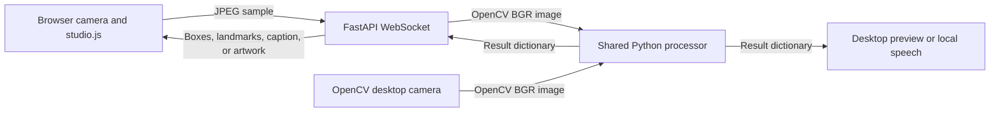

# How every function connects

Start with this map, then open the line-by-line chapter for the file you want to read. Each table describes the inputs, result, or state change that connects a function to the rest of the app.

## Follow one frame



1. The browser gets a webcam stream after you press **Start camera**. The video element plays that stream on the page. JavaScript samples a smaller JPEG for analysis and waits for a reply before sending the next one.
2. FastAPI serves the same HTML and JavaScript on all four routes. A WebSocket selects the app and owns its live state. Boxes and hand landmarks refer back to the submitted image, so the browser can put them over the preview.
3. Python decodes the snapshot into an OpenCV image. Object Motion Lab, Gesture Voice Lab, and Kinetic Silhouette each keep their own relevant history. Scene Caption Camera uses one shared, lazily loaded captioner to describe individual snapshots.
4. The server returns JSON. A motion mask travels as PNG to preserve its binary values. The particle image travels as JPEG. A caption or gesture utterance travels as text and the browser speaks it with its own speech API.
5. The desktop commands give the same processors images from OpenCV. They use desktop windows and the operating system’s speech command for output. This keeps the motion analysis and model behavior in the same Python functions for both interfaces.

## Read a response for Object Motion Lab

Suppose `ObjectMotionSession.process()` detects motion in one region. `web_server.frame_response()` adds the sampled frame dimensions and `infer()` encodes a mask if requested. If the mask is off and there are no named objects, the reply can look like this.

```json
{
  "type": "result",
  "width": 640,
  "height": 480,
  "objects": [],
  "motion": [[72, 48, 110, 90]],
  "mask": null
}
```

The motion array describes a rectangle 110 pixels wide by 90 pixels high starting at left position 72 and top position 48. `handleMessage()` reads the reply and calls `renderResult()`. The result contains the dimensions `drawBox()` uses through the canvas to align that rectangle with the video.

With **Mirror camera** on, `previewBounds()` reflects the box’s left and right edges across the 640-pixel image width. The displayed box runs from x=458 to x=568. CSS mirrors the video and the motion mask, while the renderer writes each label in its usual reading direction. Kinetic Silhouette sends the preference to Python so the person and motion masks can be reflected before drawing the scene. This keeps the decorative background fixed and preserves the motion history.

## Browser interface

The HTML names the controls and preview elements. CSS determines how those elements appear. JavaScript attaches camera and socket callbacks to the controls and translates server replies into visible or audible output. [Browser code line by line](WALKTHROUGH-WEB.md)

| JavaScript function | Role and connections |
| --- | --- |
| `get(id)` | Returns the HTML element with that ID. The script uses it to find controls, panels, status text, and preview elements. |
| `message(text)` | Sets the alert text and shows the alert only when there is a message. Startup and socket error handlers call it. |
| `cameraStatus(state, text)` | Updates the status label and the matching CSS state. The camera lifecycle uses it during startup, live capture, and shutdown. |
| `updateCaptionControls()` | Makes **Describe frame** available when the socket is ready and idle, and **Speak caption** available when a caption exists. |
| `readWords(sequence)` | Combines a returned word list into the transcript display and enables the playback and clear controls when words exist. |
| `resetPreview()` | Clears the mode-specific output and restores the inactive preview. `stopCamera` calls it when a session ends. |
| `stopCamera(error)` | Cancels timers, stops camera tracks and speech, closes the WebSocket, and resets the interface. It invalidates the session before cleanup so late replies cannot affect a new session. |
| `sendControl(payload)` | Sends a settings update or transcript command as JSON on the active WebSocket. Python reads these messages in `apply_command`. |
| `sendSettings()` | Reads the selected mode’s interface controls and sends detection, speech, or silhouette preferences to the server. |
| `updateMirror()` | Applies the mirror state to the video and mask display and redraws the previous overlay immediately. In silhouette mode it also sends the preference to Python. |
| `speak(text)` | Passes an utterance to the browser’s speech API and replaces ongoing playback. Captions and gesture replies both use it. |
| `scheduleFrame(session, delay)` | Replaces the pending snapshot timer with a new one that invokes `sendFrame`. |
| `scheduleNext(session)` | Chooses when to sample again after a reply. Live modes use a short delay. Automatic captions wait longer, and manual captions wait for the next click. |
| `sendFrame(session)` | Confirms the current session is ready, draws a resized snapshot onto a canvas, encodes it as JPEG, and sends it as a binary WebSocket message. The pending flag prevents an overlapping image request. |
| `colorFor(label)` | Reduces a label’s characters to a repeatable palette index so its box and result row use the same color. |
| `drawBox(box, color, label)` | Calls `previewBounds` to position and clip the box, then draws the rectangle and its text label. |
| `drawHands(hands)` | Converts normalized landmark coordinates to canvas pixels, applies `previewX`, and draws joints and their connections. |
| `renderObjects(result)` | Calls `drawBox` for returned objects and motion regions, lists scores and region counts, and updates the optional mask. |
| `drawOverlay(result)` | Sizes the canvas from the sampled frame and redraws the object or hand geometry. Both a new result and a mirror toggle can call it. |
| `renderResult(result)` | Routes a reply to the relevant drawing or display code. It updates object results, hand landmarks and transcript, caption text, or the silhouette image and motion meter. |
| `handleMessage(session, data)` | Parses the server’s ready, result, gesture, and error messages. It ignores stale sessions, clears the pending flag after a frame, and schedules the next sample when appropriate. |
| `startCamera()` | Requests webcam access, attaches the stream to the video element, connects to the correct WebSocket route, and installs message and close handlers. It releases late camera streams if the visitor has already stopped. |
| `previewX(x, frameWidth, reflected)` | Returns the horizontal coordinate unchanged for a normal preview or subtracts it from the frame width for a reflected preview. It lives in `web/mirror.mjs` so the browser and Node.js tests can use the same math. |
| `previewBounds(x, boxWidth, frameWidth, reflected)` | Calls `previewX` for both box edges, orders them left to right, and clips them to the display bounds. |

Inline callbacks in the last part of the script connect the buttons and checkboxes to these functions. The page navigation callback stops the camera when the visitor leaves. The line-by-line chapter covers those callbacks at their definitions.

## Python web transport

FastAPI and Uvicorn handle the connection. The transport helpers convert between the browser’s messages and Python’s image arrays. [Server code line by line](WALKTHROUGH-SERVER.md)

| Python function | Role and connections |
| --- | --- |
| `lifespan(app)` | Creates the shared captioner, a lock to serialize caption jobs, and a limit on concurrent sessions when the app starts. |
| `page(mode)` | Serves the shared HTML for a supported mode and returns HTTP 404 for unknown modes. |
| `decode_frame(payload)` | Checks JPEG byte size and image dimensions, reads RGB pixels, then returns a BGR array for OpenCV. `frame_response` runs it before inference. |
| `image_url(image, extension, mime)` | Encodes an OpenCV image and wraps the bytes in a Base64 data URL so JSON can carry the visual result. |
| `infer(session, frame, now)` | Invokes the mode’s `process` method. It encodes the motion mask or sizes and encodes particle art when present. |
| `apply_command(mode, session, message)` | Decodes text messages and changes the current session’s controls. For gestures, it calls `clear` or `utterance` and returns the updated transcript or phrase. |
| `open_session(mode)` | Looks up the live processor and enters its context. Captioning uses the captioner from `lifespan` instead. |
| `frame_response(state, mode, session, payload)` | Runs decoding and computer vision off the async loop, choosing `Captioner.describe` for captions and `infer` for the other apps. It adds the dimensions to the JSON-ready result. |
| `stream(websocket, mode)` | Checks the route and origin, claims a session slot, and dispatches each binary image or text command. It sends results and closes the vision session when the connection ends. |

## Desktop camera, speech, and model setup

The desktop loops combine a `Camera` with the same Python processor the web server selects. Setup downloads the model files before either interface needs them. [Camera and speech code line by line](WALKTHROUGH-SHARED.md) · [Setup code line by line](WALKTHROUGH-SETUP.md)

| Function or method | Role and connections |
| --- | --- |
| `camera.camera_parser(description)` | Creates the common desktop command parser with mutually exclusive camera index and video file choices. |
| `camera.camera_args(parser)` | Parses the command line and rejects a negative camera index or a missing video file. |
| `camera.fit_preview(frame)` | Fits frames within 960 by 640 pixels without enlargement or aspect-ratio distortion. `Camera.__iter__` applies it. |
| `camera.Camera.__init__(args)` | Records the camera or file source and initializes the time, frame index, and window state. |
| `camera.Camera.__enter__()` | Opens the source with OpenCV, checks that it opened, and records the playback timing used by the iterator and window. |
| `camera.Camera.__iter__()` | Yields preview-sized frames, updating time from the video frame rate or elapsed capture time. It stops at file end and reports a capture failure. |
| `camera.Camera.show(title, frame)` | Shows a frame, paces recorded playback, and returns a key. It returns `None` when a quit key is pressed or a previously visible window closes. |
| `camera.Camera.__exit__()` | Releases capture and closes OpenCV windows when the desktop loop exits. |
| `camera.model_file(name)` | Locates a model under the common models directory and points the user toward setup if the file is missing. |
| `camera.vision_image(frame)` | Converts an OpenCV BGR frame to RGB, then wraps it as a MediaPipe image for the object, gesture, or silhouette model. |
| `camera.draw_panel(frame, lines)` | Draws desktop status and controls over a frame, adapting text size to the available width. |
| `camera.run_app(main)` | Runs a desktop or setup entry point and turns a handled error into a message and a nonzero exit code. |
| `speech.Speech.__init__()` | Finds macOS `say` or an available eSpeak command and initializes the playback handle. |
| `speech.Speech.__enter__()` | Returns the speech controller for a desktop `with` block. |
| `speech.Speech.speak(text)` | Starts the OS speech command for nonempty text after stopping the previous utterance. Gesture and caption desktop loops call it. |
| `speech.Speech.stop()` | Terminates an existing speech process and forces cleanup if it does not exit promptly. |
| `speech.Speech.__exit__()` | Calls `stop` so a desktop session does not leave its speech process running. |
| `download_models.download(name, url, expected_hash)` | Checks an existing model’s SHA-256 checksum or streams a new copy to a temporary file. It verifies the new copy before replacing the destination. |
| `download_models.main()` | Selects one project or all of them, then calls `download` for each pinned artifact. |

## Object Motion Lab

`ObjectMotionSession.process` combines two analyses. Motion detection compares the previous and current frame. Object recognition runs a model on periodically sampled frames and tracks its boxes between model calls. [Object and motion code line by line](WALKTHROUGH-OBJECTS.md)

| Function or method | Role and connections |
| --- | --- |
| `motion_detector.prepare_frame(frame)` | Converts the BGR frame to grayscale and applies Gaussian blur to reduce small pixel fluctuations before comparing frames. |
| `motion_detector.detect_motion(previous, current, threshold, min_area)` | Calculates absolute pixel differences, thresholds them, joins nearby regions, and finds contour boxes above the area cutoff. It returns the binary mask and boxes. |
| `motion_detector.draw_motion(frame, boxes)` | Draws the motion boxes and labels on the OpenCV desktop preview. The browser draws the same returned coordinates on its canvas. |
| `motion_detector.ObjectMotionSession.__init__(...)` | Stores the analysis settings and initializes a tracker, model handle, timing, and previous frame for this session. |
| `motion_detector.ObjectMotionSession.__enter__()` | Returns the session. Named-object inference loads its model when first requested. |
| `motion_detector.ObjectMotionSession.__exit__()` | Closes the detector if the session loaded it. |
| `motion_detector.ObjectMotionSession.process(frame, now)` | Checks dimensions and selected mode, updates named tracks when inference is due, compares the current image against the prior grayscale frame, and returns objects, region boxes, and the optional mask. |
| `motion_detector.parse_args()` | Adds the mode, confidence, motion thresholds, and mask controls to the common desktop parser, then validates their combinations. |
| `motion_detector.main()` | Reads the desktop source, calls the shared session, draws results, and exits when the camera window or input ends. |
| `object_detection.Detection` | A dataclass that bundles one confirmed or candidate object label, score, and box. Its constructor is generated by Python. |
| `object_detection.Track` | A dataclass that bundles a detection, last-seen timestamp, and hit count for the tracker. Its constructor is generated by Python. |
| `object_detection.intersection_over_union(first, second)` | Divides the area shared by two boxes by their combined area. The tracker uses this overlap to match detections across samples. |
| `object_detection.ObjectTracks.__init__()` | Starts a fresh list of tracked detections. |
| `object_detection.ObjectTracks.update(detections, now)` | Matches same-label boxes by overlap, smooths matched coordinates, increments hits, and retains recently confirmed tracks. |
| `object_detection.ObjectTracks.visible(now)` | Returns sufficiently confirmed detections whose last observation was recent. The session can use these between inference calls. |
| `object_detection.create_detector(confidence)` | Opens the pinned EfficientDet model in MediaPipe with the chosen minimum score and a result count limit. |
| `object_detection.fit_for_model(frame)` | Pads an aspect-ratio-preserving resize to the model’s square input and returns the offsets and scales needed to reverse that transform. |
| `object_detection.infer_objects(detector, frame)` | Runs the model on the padded image and maps the predicted rectangles back to original image coordinates. |
| `object_detection.draw_objects(frame, detections)` | Draws clipped desktop boxes and category badges with scores. |

## Gesture Voice Lab

MediaPipe supplies the hand landmarks and candidate gesture. The Python session decides whether a stable hold has earned a word or a request to speak the sequence. [Gesture code line by line](WALKTHROUGH-GESTURE.md)

| Function or method | Role and connections |
| --- | --- |
| `read_pose(result)` | Reads the recognized hand count and top categories above the confidence threshold. It translates a supported single-hand pose to a word or two open palms to a sequence playback command. |
| `PoseHold.__init__()` | Starts a new hold with no candidate, no release timer, and no active lock. |
| `PoseHold.update(hands, candidate, now)` | Measures a stable hold, requires a release between accepted gestures, and reports progress plus the accepted action when the hold crosses its threshold. |
| `draw_hands(frame, hands)` | Draws the normalized hand joints and connection paths on the desktop preview. |
| `GestureSession.__init__(speak_each)` | Creates the empty word list, hold state, speech preference, and model timestamp. |
| `GestureSession.__enter__()` | Loads the MediaPipe gesture recognizer in video mode with a two-hand limit. |
| `GestureSession.__exit__()` | Releases the recognizer when the interface closes its session. |
| `GestureSession.clear()` | Empties the current transcript. Browser and desktop controls call this directly or through `apply_command`. |
| `GestureSession.utterance()` | Joins the current transcript into the string the browser or operating system can speak. |
| `GestureSession.process(frame, now)` | Runs MediaPipe, then calls `read_pose` and `PoseHold.update`. It may add a word or produce an utterance and returns landmarks, transcript, and status for the interface. |
| `main()` | Reads desktop frames, calls the gesture session, draws results, and responds to speech or clear keys. |

## Scene Caption Camera

The visual encoder turns a single image into features. The language decoder turns those features into text one token at a time. [Caption code line by line](WALKTHROUGH-CAPTIONS.md)

| Function or method | Role and connections |
| --- | --- |
| `image_tensor(frame)` | Resizes and converts an OpenCV image to a normalized RGB tensor in the shape the ONNX encoder expects. |
| `generate_tokens(decoder, image_features)` | Starts at the model’s start token, chooses the highest-scoring next token, and feeds the attention cache forward until the end token or the iteration limit. |
| `load_model()` | Opens the pinned ONNX encoder, decoder, and tokenizer. The captioner calls it on the first request. |
| `Captioner.__init__()` | Records that no weights have been loaded yet. |
| `Captioner.describe(frame)` | Creates the image tensor, runs the visual encoder, generates token IDs, and decodes them into a sentence. Server and desktop both call it. |
| `main()` | Runs the desktop preview, submits caption jobs to a worker for a key press or automatic interval, and speaks requested captions without doing inference within the preview loop. |

## Kinetic Silhouette

The segmentation model finds body pixels. Frame differencing highlights changes within the body and the renderer turns the result into a landscape. [Silhouette code line by line](WALKTHROUGH-SILHOUETTE.md)

| Function or method | Role and connections |
| --- | --- |
| `make_landscape()` | Builds the reusable night landscape on which the session draws particles. |
| `small_frame(frame)` | Reduces the frame to a manageable segmentation size while preserving its orientation and aspect ratio. |
| `person_mask(segmenter, frame, milliseconds, previous)` | Runs MediaPipe segmentation and uses confidence and previous foreground state to stabilize the person mask across samples. |
| `body_motion(previous_gray, previous_person, gray, person)` | Finds changing pixels, compensates for large scene-wide brightness shifts, and retains cleaned motion regions within the current person mask. |
| `draw_particles(landscape, person, moving)` | Projects sampled foreground pixels onto the landscape and uses gold for moving particles. |
| `draw_mask(person, moving)` | Renders a diagnostic view of the two masks so you can inspect person and movement pixels directly. |
| `SilhouetteSession.__init__()` | Builds the background and initializes the previous images, timestamp, display mode, and mirror preference. |
| `SilhouetteSession.__enter__()` | Opens the pinned MediaPipe person segmenter with video-mode confidence masks. |
| `SilhouetteSession.process(frame, now)` | Resizes the frame, runs segmentation and motion analysis, and updates previous-frame state. If mirroring is on, it reflects the result masks before drawing. It returns art, body presence, and the percentage of body pixels in motion. |
| `SilhouetteSession.__exit__()` | Closes the segmenter when the caller finishes. |
| `main()` | Shows the processed art in a desktop window. It changes the session’s mask setting when you press **M**. |

## Test functions

Run `.venv/bin/python -m unittest -v` from the project folder. Where the tests use a synthetic frame, a model double, or an in-process socket, the purpose is to isolate one behavior from the camera, network, and operating system.

| Function | What it checks |
| --- | --- |
| `CameraWindowTest.test_window_can_open_before_it_becomes_visible` | A window that is initially hidden gets time to appear. It is treated as closed only after it has been visible. |
| `test_gesture_voice.result` | Creates a lightweight recognizer result from specified labels and a confidence score. Other gesture tests supply those fixtures to the same pose logic the live app uses. |
| `GestureVoiceTest.test_pose_mapping_and_confidence` | Checks category-to-word mapping and the minimum confidence, including the two-palm action. |
| `GestureVoiceTest.test_word_acceptance_and_release` | Checks that the hold accepts one word, then requires the hand to disappear before another hold starts. |
| `GestureVoiceTest.test_dropped_frames_reset_progress` | Checks that a long sample gap resets a two-hand hold instead of counting elapsed time with no samples. |
| `GestureVoiceTest.test_session_reports_landmarks_and_speech_once_per_hold` | Drives the session with a fake recognizer to check the returned landmarks, transcript, one speech request, and model cleanup. |
| `SilhouetteTest.test_motion_stays_in_person_and_ignores_uniform_brightness_shift` | Uses synthetic masks to check that a camera-wide brightness change and activity outside the body do not light up the silhouette. |
| `SilhouetteTest.test_new_foreground_glows_and_both_views_show_motion` | Checks that newly occupied body pixels register as motion and show up in both display modes. |
| `SilhouetteTest.test_shared_session_owns_history_and_closes_model` | Checks that one session’s previous frames are used on its next frame and that the segmenter closes. |
| `SilhouetteTest.test_mirror_reflects_subject_without_counting_it_as_motion` | Changes the mirror preference between identical frames and checks the subject’s position and the motion percentage. |
| `MotionDetectorTest.test_still_noise_and_motion` | Compares artificial frames to distinguish stillness, small noise, and a valid changed region. |
| `MotionDetectorTest.test_single_session_can_switch_between_motion_and_objects` | Switches the same session between modes and checks history, model calls, and returned fields. |
| `ObjectTracksTest.test_confirm_smooth_and_expire` | Checks that a track withholds its first detection, smooths a match, and expires after the hold time. |
| `ObjectTracksTest.test_same_name_can_have_distinct_boxes` | Checks that two separate objects with the same label remain two distinct tracks. |
| `ObjectTracksTest.test_letterbox_preserves_wide_frame_geometry` | Checks the model resize and padding math against a wide synthetic image. |
| `CaptionTests.test_image_tensor_is_rgb_normalized_and_channels_first` | Checks the encoder’s input shape, channel order, and numeric normalization. |
| `CaptionTests.test_decoder_reuses_its_cache_until_the_end_token` | Checks that the token loop passes the decoder’s returned cache into the next iteration and stops at the end token. |
| `Decoder.run` in the caption test | Acts as a miniature decoder. It records the supplied inputs and returns controlled tokens and cache values so the test can inspect the loop. |
| `test_web_server.jpeg` | Encodes a test array into the binary format the WebSocket accepts. |
| `BrowserAPI.test_decode_accepts_jpeg_in_bgr_and_checks_size` | Checks decoder output channel order and the message or image limits. |
| `BrowserAPI.test_socket_motion_sessions_are_isolated_and_recover_from_bad_input` | Sends synthetic frames through two WebSockets to verify independent baselines and successful recovery after malformed input. |
| `BrowserAPI.test_socket_rejects_another_origin` | Checks that a connection from an outside origin is rejected. |

The three cases in `test_mirror.test.mjs` call the same mirror helpers as the browser. They check landmark positions in both orientations, box width after reflection, and clipping at the camera boundary. The browser chapter explains these tests with the mirror code.
